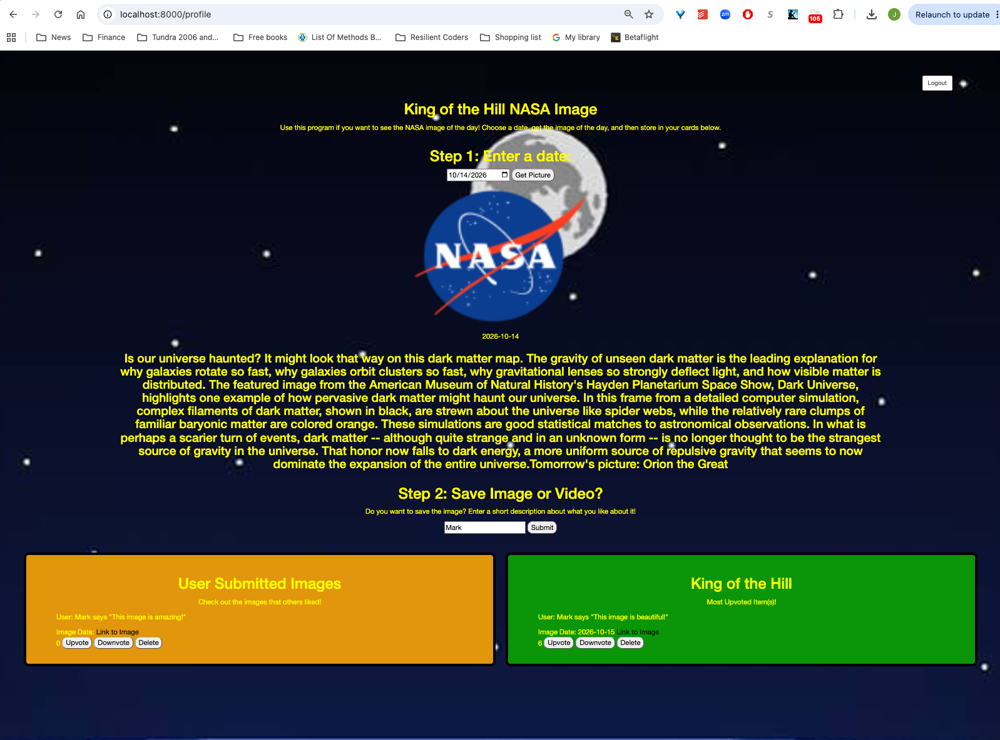

# Fullstack-NASA-Image
Use this program if you want to leave a message on a forum!

# 📋 How to use
Use this link: 
Enter a message.
Post items that have an impulse to buy, and then move to actual wish list once you're sure you want to buy!

# 📷 Images

# ✨ Features
Fully responsive design for desktop and mobile.

# 🔨 Built With
HTML5 – structure,
CSS3 – responsive design and background,
JavaScript - frontend and backend.

# 🧠 What I Learned
How to work with Node.
How to work with APIs.
How to use fetch().
How to work with JSON data.
How to manipulate the DOM.
How to handle errors.